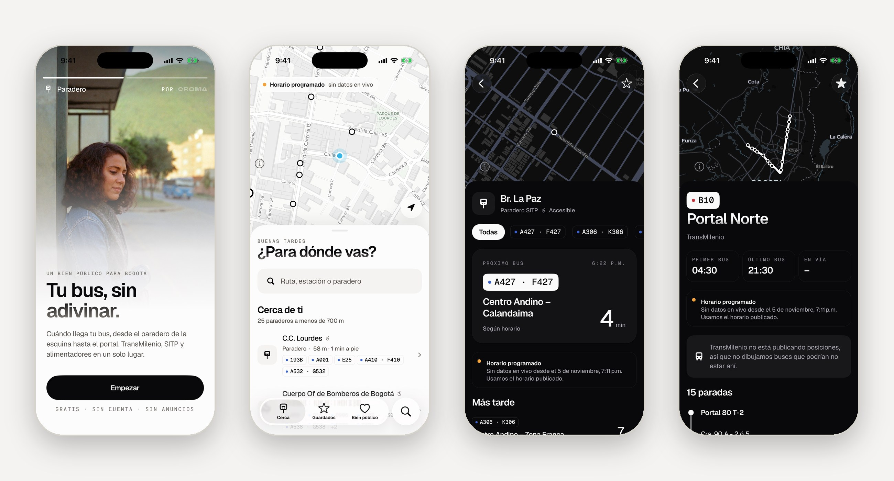

# Paradero

**Tu bus, sin adivinar.** La app abierta para moverse en Bogotá: TransMilenio, SITP, alimentadores y TransMiCable en un solo lugar.

Un bien público digital de [Croma](https://usecroma.com) · Datos abiertos de TransMilenio · Licencia MIT · [Privacidad](https://paradero.expo.app/politica-de-privacidad) · No es una app oficial del Distrito.



## Un bien común, para el Estado y para la gente

Paradero es parte de **Bienes Públicos Digitales de Croma**: herramientas abiertas, construidas sobre datos públicos, que le pertenecen a todos.

**La ponemos a disposición de la Alcaldía de Bogotá, la Secretaría Distrital de Movilidad y TransMilenio S.A.** para que la adopten, la publiquen con su nombre, la mantengan y la mejoren. Sin costo y sin condiciones. Si una entidad decide hacerlo, Croma acompaña la entrega: despliegue, documentación, cuentas de las tiendas y lo que haga falta para que funcione sin depender de nosotros.

Lo hacemos porque la ciudadanía merece las mejores herramientas, no las que sobran. Una app pública puede sentirse tan cuidada como la mejor app privada del mundo.

## Lo que escuchamos

Publicamos un mapa con cada bus de TransMilenio en vivo y recibimos más de 150 comentarios. Casi ninguno era sobre los datos: eran sobre lo difícil que es moverse. Esto es lo que pidieron:

| Lo que nos dijeron | Qué hace Paradero |
| --- | --- |
| "¿En cuánto llega a mi estación?" | Próximos buses por paradero, en minutos grandes, con si va a tiempo o tarde |
| "Ver todos los buses que vienen a mi paradero" | El mapa del paradero muestra los buses en camino de todas sus rutas, con filtro por ruta |
| "Mi ruta no aparece" (K635, G545, A334, B903, A538) | TransMilenio publica las rutas SITP en pareja con un solo código (`HK635`). Paradero las separa y las encuentra como dice el bus |
| "La app oficial no se entiende" | Una pregunta por pantalla, letra grande, pensada para una mano |
| "No se actualiza" | Siempre dice si el dato es en vivo o del horario publicado, y nunca dibuja buses viejos como actuales |
| "Guardar mis rutas" | Paraderos y rutas guardados, con sus próximos buses en la pantalla principal |

## Lo que prometemos

- **Sin cuenta.** Abres la app y ya.
- **Sin publicidad, nunca.**
- **Tu ubicación no se guarda.** Se pide con una explicación, solo con la app abierta, y sale del teléfono redondeada a una cuadra.
- **Honestidad con el dato.** Si TransMilenio deja de publicar posiciones, lo ves en pantalla.
- **Para todas las personas.** Cumple WCAG 2.2 AA, como pide la Resolución 1519 de 2020 a los servicios digitales del Estado, y tiene alto contraste AAA. Sigue la accesibilidad del teléfono: VoiceOver y TalkBack con frases completas, texto grande que reorganiza la pantalla en vez de cortarla, negrita, más contraste, menos movimiento y menos transparencia. Los paraderos accesibles van marcados.
- **Cuida tus datos móviles.** Respuestas compactas y nada se actualiza en segundo plano.

## Estándar de Bienes Públicos Digitales

Paradero está construida para cumplir los nueve indicadores del [Digital Public Goods Standard](https://digitalpublicgoods.net/standard/). Nuestro objetivo es postularla al registro de la Digital Public Goods Alliance.

| Indicador | Cómo lo cumple |
| --- | --- |
| 1. Relevancia para los ODS | ODS 11, meta 11.2: transporte público accesible y asequible. ODS 10: reducción de desigualdades |
| 2. Licencia abierta | [MIT](LICENSE) |
| 3. Propiedad clara | Croma y quienes contribuyen, declarado en la licencia |
| 4. Independencia de plataforma | Código abierto de punta a punta: Expo y React Native, mapas MapLibre sobre OpenStreetMap, sin Google Maps. La fuente de datos se cambia en `src/server` |
| 5. Documentación | Este README, [`docs/PLAN.md`](docs/PLAN.md) y [`AGENTS.md`](AGENTS.md) |
| 6. Extracción de datos | Los datos son los abiertos de TransMilenio (GTFS y GTFS-RT) y la API del proyecto responde JSON |
| 7. Privacidad y ley | No recolecta datos personales. Pensada para la Ley 1581 de 2012 de protección de datos |
| 8. Estándares | GTFS, GTFS-Realtime, OpenStreetMap, WCAG 2.2 AA (contraste comprobado en cada cambio) y pautas de accesibilidad de iOS y Android |
| 9. No hacer daño | Sin anuncios, sin rastreo, sin datos personales y sin presentar horarios como si fueran en vivo |

## Correrla

```bash
git clone https://github.com/croma-labs/paradero
cd paradero
npm install
cp .env.example .env.local   # pega tu CROMA_API_KEY, gratis en platform.usecroma.com
npx expo run:ios             # o: npx expo run:android
```

El mapa usa código nativo, así que necesita un development build (no Expo Go). Antes de un PR: `npx tsc --noEmit` y `npx eslint src`.

## Cómo funciona

```
App (Expo, iOS y Android)
  └─ /api/*   rutas de servidor en el mismo proyecto
       └─ Croma API  →  datos abiertos de TransMilenio
```

La llave de la API vive solo en el servidor. Cada respuesta se comparte unos segundos entre todos los usuarios, así la fuente recibe las mismas consultas con una persona que con cien mil.

| Ruta | Qué devuelve |
| --- | --- |
| `GET /api/nearby?lat&lon` | Paraderos y estaciones cercanos |
| `GET /api/search?q` | Rutas y paraderos por código o nombre |
| `GET /api/stops/:id` | Paradero, próximos buses, buses en camino y novedades |
| `GET /api/routes/:id` | Recorrido, paradas, buses en vía y novedades |
| `GET /api/health` | Si TransMilenio está publicando en vivo |

Expo SDK 58 · Expo Router con pestañas nativas · Liquid Glass · MapLibre · TanStack Query · SQLite local · Zod · con la identidad de Croma (Geist, Geist Mono y Victor Mono), en claro y oscuro.

## Lo que sigue

- **Pregúntale a Paradero:** modo agente en lenguaje natural ("¿cómo llego a la Nacional?") que responde con datos en vivo y las mismas tarjetas de la app.
- Avisos de tu ruta a la hora en que la tomas, Live Activity y widget.
- Planeador de viajes con transbordos sobre el GTFS.
- Reportes de la comunidad: qué tan lleno viene, cierres, buses varados.
- Otras ciudades cuando publiquen datos abiertos equivalentes.

## Contribuir

La construimos con la gente que la usa. Si diseñas, programas, haces UX, accesibilidad o seguridad, o tomas el SITP todos los días y tienes una idea, abre un [issue](https://github.com/croma-labs/paradero/issues). Desde la app también puedes reportar sin cuenta: llega aquí como un issue público con la etiqueta `reporte ciudadano`, sin tu correo ni tu teléfono.

- Español claro, como hablaría un vecino.
- Cada dato dice de dónde viene y qué tan fresco es.
- Cada botón tiene etiqueta para lectores de pantalla.
- Nada de datos personales sin discutirlo primero.

## Licencia

[MIT](LICENSE). La elegimos porque es la forma más simple de que una entidad pública o sus contratistas adopten el código sin trámites, y porque un bien común no debería pedir permiso para usarse.

Las fuentes Geist, Geist Mono y Victor Mono vienen con la [SIL Open Font License 1.1](https://openfontlicense.org).

Los datos de transporte son de TransMilenio S.A. Los mapas son de [CARTO](https://carto.com/attributions) y © colaboradores de [OpenStreetMap](https://www.openstreetmap.org/copyright). Las fotos del onboarding son imágenes generadas con IA, no personas reales.

---

**In English.** Paradero is a free, open-source app for getting around Bogotá: live arrivals per stop, the buses heading to your stop, route search that reads codes the way riders do, saved stops and plain-language service alerts. It is part of Croma's Digital Public Goods series, built to meet the Digital Public Goods Standard, and offered at no cost to the City of Bogotá and TransMilenio to adopt and maintain. MIT licensed.
