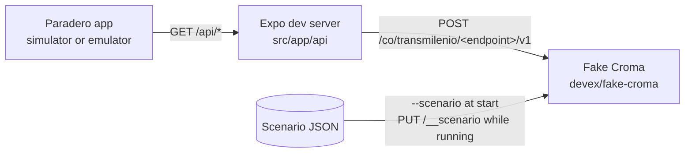

# Fake Croma

A local stand-in for Croma, the TransMilenio data feed. The app runs on a simulator or emulator without a Croma key, and it shows exactly the stops, buses and arrival times you describe. That makes it the base for acceptance checks: "the K86 is 2 minutes from Br. La Clarita and the rider is waiting there" becomes a small JSON file.

```bash
npm run dev:fake                                       # expo start, default scenario
npm run dev:fake -- run:ios                            # build and open on the iOS simulator
npm run dev:fake -- run:android                        # build and open on the Android emulator
npm run dev:fake -- --scenario path/to/case.json run:ios   # start from your own scenario
npm run croma:fake                                     # only the fake, on http://127.0.0.1:4010
```

Anything after `--`, except `--scenario`, goes to `npx expo`. `dev:fake` sets `CROMA_API_URL` and `CROMA_API_KEY` for that run only. Values from the shell win over `.env.local`, so a real key in `.env.local` is never sent anywhere.

The phone never talks to the fake. The app calls its own API routes on the dev server, and those routes call the fake instead of `api.croma.run`:



## Scenarios

A scenario is the whole world the fake answers from. [`scenarios/default.json`](scenarios/default.json) is a normal weekday around Calle 72; [`scenario.ts`](scenario.ts) documents every field. A minimal one:

```json
{
  "about": "The K86 is 2 minutes from Br. La Clarita, where the rider is waiting.",
  "rider": { "stop": "CLARITA" },
  "stops": [
    { "id": "CLARITA", "name": "Br. La Clarita", "lat": 4.6812, "lon": -74.1301 },
    { "id": "FONTIBON", "name": "Hospital Fontibón", "lat": 4.6741, "lon": -74.1412 }
  ],
  "routes": [{ "code": "K86", "longName": "Portal El Dorado", "system": "zonal_urbano", "patterns": [{ "stops": ["FONTIBON", "CLARITA"] }] }],
  "buses": [{ "id": "K86-1", "plate": "WMK-086", "route": "K86", "between": ["FONTIBON", "CLARITA"], "at": 0.8 }],
  "arrivals": [{ "stop": "CLARITA", "route": "K86", "minutes": 2, "bus": "K86-1" }]
}
```

| To get | Write |
| --- | --- |
| A bus on route X heading to stop Y | a `buses` entry with `route: X` and `between: [<stop before Y>, Y]`; `at` is how far along (0 to 1) |
| "Comes in N min" at stop Y | an `arrivals` entry with `stop: Y`, `minutes: N`; `basis` is `predicted` (default), `estimated` or `scheduled` |
| A stop with nothing coming | the stop, with no `arrivals` for it |
| A paired SITP route | `code: "HK635"`, `longName: "K635 Montevideo \|\| H635 Arborizadora Alta"`; the app shows it as K635 · H635 |
| The feed showing the timetable | `"feed": { "live": false }`, or `"feed": { "ageSeconds": 600 }` (more than 5 minutes old) |
| Croma down | `"down": "all"`, or a list such as `["stop-arrivals"]`; those endpoints answer 503 |
| A service alert | an `alerts` entry; `description` uses TransMilenio's format, e.g. `DESVIO\\063A00_Calle 63\\076A00_Calle 76` reads "between Calle 63 and Calle 76" |

Times are counted from each request, so "2 minutes" stays 2 minutes. The fake refuses a scenario that doesn't hold together, such as a bus on a route that doesn't exist or between stops its route never visits, and says why.

## Changing the scenario while the app runs

```bash
curl -X PUT http://127.0.0.1:4010/__scenario --data-binary @case.json   # answer from this one now
curl http://127.0.0.1:4010/__scenario                                   # what it answers from
curl -X POST http://127.0.0.1:4010/__scenario/reset                     # back to the starting one
```

The app's server keeps Croma's answers in memory: live data (arrivals, buses, feed) for 3 seconds, alerts for 2 minutes, nearby stops for 5 minutes, search for 30 minutes, and a stop or route's own details for up to 6 hours. So:

- Changes to arrivals, buses and the feed show within one refresh, about 5 seconds. Use this to move a bus closer during a check.
- When you change stops, routes or alerts, use new ids, or restart `dev:fake` with `--scenario` so nothing old is kept.
- To test Croma being down, start with that scenario. Otherwise the app's server keeps serving its last live answer for up to 90 seconds, which is the behaviour riders get too.

## Putting the device where the rider is

The fake reports the rider's position (`GET /health`, and in its log), but the device's location is set separately:

```bash
xcrun simctl location booted set 4.6812,-74.1301   # iOS simulator
adb emu geo fix -74.1301 4.6812                    # Android emulator: longitude first
```

Deep links open a screen directly: `paradero://stop/CLARITA`, `paradero://route/R-K86`. A route's id is `R-<code>` unless the scenario sets one. On iOS, the first link from `simctl openurl` asks "Open in Paradero?" and someone has to tap Open.

## Changing the fake

The fake checks each answer against `src/server/schemas.ts`, the schemas the app's server reads the real Croma with. If the fake's answers ever stop matching, it returns a 500 (`fake_out_of_date`) and prints what is wrong, so bad data never reaches the app.

Set `FAKE_CROMA_PORT` to use another port. Set `FAKE_CROMA_LOG=1` with `dev:fake` to print every request the app's server makes; `croma:fake` always prints them. `FAKE_CROMA_SCENARIO` works like `--scenario`.

Rider reports (`/api/report`) still go to GitHub and are not faked.
